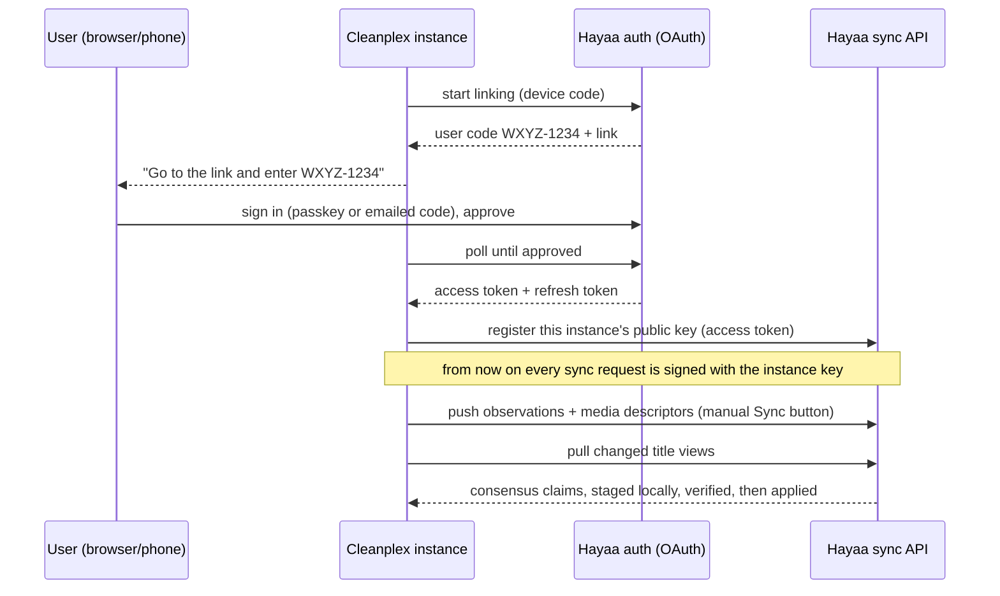

# Connecting Cleanplex to Hayaa, the shared scene service

Status: design for the Cleanplex side. The service is **Hayaa** (حياء), developed locally in `~/Code/cleanplex-sync` (not deployed yet). Hayaa only stores and shares segment information; it has no connection to any media server. Nothing in this repository changes until this plan and the rule changes in §9 are agreed.

This replaces today's GitHub sync (`cleanplex/sync.py`, `cleanplex/sync_merge.py`): no GitHub repo or token, no per-instance JSON slots, and conflicts resolved by the service's consensus instead of at download.

## 1. In one picture

## Naming

Cleanplex keeps its name. Everything that belongs to the integration uses the service's name, **Hayaa**:
- **UI:** the Settings page "Hayaa", the buttons "Sign in to Hayaa" and "Sync with Hayaa", and segments labelled "from Hayaa".
- **Code:** the module `cleanplex/hayaa.py` (replacing `sync.py` and `sync_merge.py`) and the `hayaa_*` tables.
- **Data:** the `hayaa/` folder in the data directory.

On the Hayaa side, a linked instance shows up as "Cleanplex server", because that is the device.

## 2. Linking (once per instance)

1. **Settings → Hayaa → Sign in to Hayaa.** Cleanplex calls `POST {auth}/oauth/device_authorization` with `client_id=cleanplex`. It shows the returned user code and link: "On any phone or computer, go to … and enter WXYZ-1234".
2. **The user signs in on the Hayaa site** with a passkey or an emailed 6-digit code, names the device ("Living-room server") and approves. Cleanplex never sees the email address.
3. **Cleanplex polls** `POST {auth}/oauth/token` (every 5 s, longer if told `slow_down`) and receives an access token (15 minutes) and a refresh token (90 days, rotates on every use).
4. **Cleanplex generates an Ed25519 keypair** and registers the public key with `POST {api}/api/v1/keys/add`, using the access token.
5. **Two files are stored in the data directory**, both with 0600 permissions and **excluded from `db_backup`** archives a user might share:
   - `hayaa/sync.key`: the private key.
   - `hayaa/cleanplex.token`: the refresh token.
6. **Unlinking** (Settings → Hayaa, or the account page on the Hayaa site) revokes the device and its key at once. Cleanplex then shows "Not linked to Hayaa" and keeps its outbox.

All of this is implemented in the service's client library: `hayaa.client.SyncClient.link(show=...)`. Cleanplex depends on the `hayaa` package rather than re-implementing signing.

## 3. What Cleanplex sends

### 3.1 Observations (`POST /api/v1/push`, signed)

Append-only records. The service never overwrites anything a user sent; it derives consensus from all of them.

| Kind | Sent when | Main fields |
|---|---|---|
| `detect` | A scan finds a segment | time range, detector family (`nudenet`, `siglip`, `subtitles`), detector version, `scan_id`, labels, confidence |
| `clean` | A full scan finds nothing | detector, version, `scan_id` |
| `verify_hit` / `verify_miss` | The verifier re-checks a pulled claim (§6) | claim id, detector, version, best confidence |
| `add` | User adds a segment by hand | time range, category label |
| `confirm` | User keeps a pulled segment during review | claim id |
| `reject` | User marks "false positive: nothing is there" | claim id |
| `bounds` | User edits start/end | claim id, new range |
| `label` | User relabels | claim id, labels |
| `retract` | User deletes their own segment, or a newer scan supersedes it | ids of this user's earlier observations |

Every observation carries a client-generated `id`, so a retry after a timeout is free and never duplicates. Time ranges are in the file's own timeline, in seconds.

### 3.2 Media descriptors (`POST /api/v1/media`, signed)

One per title, so the service (and future players) can find the file:
- `title`: the **content key**, a SHA-256 over the file size and 16 sampled 64 KB chunks (`hayaa.protocol.contentkey`). It replaces the full-file SHA-256 of `compute_file_hash`, reads about 1 MB per file, and can also be computed from a stream.
- `release_key`: a hash of the **file name and exact size**. The name itself is never sent.
- `ids`: TMDB, IMDb and TVDB ids from Plex metadata; season and episode for shows. Stored as hashes on the service.
- `runtime`.

### 3.3 Never sent

- Titles, file names or paths in readable form, Plex tokens, server addresses, usernames, emails.
- Thumbnails or any video frames.
- **Segments from imported skip files.** They are third-party data (rule §5.4), so they never reach the outbox.
- **Preferences:** category levels, thresholds and "don't skip this for me". Those stay on the instance.

## 4. What Cleanplex receives

`POST /api/v1/pull` with up to 500 `{content key: version held}` pairs per request. The service returns only titles whose version changed, so an unchanged library costs almost nothing.

Each title view contains, per claim:
- `claim_id`, start/end (seconds), labels and severity.
- `status`: `candidate`, `accepted`, `disputed` or `rejected`.
- `basis`: `machine`, `human` or `both`, plus the best confidence per detector family.
- Supporter and rejecter counts, and a version.
- `clean: true` when at least two contributors scanned the title and found nothing.

The client library validates every response before Cleanplex touches it: size caps, ranges inside the local runtime, known labels only. Anything invalid is dropped.

## 5. Local changes in Cleanplex

**Database**
- `hayaa_claims`: staging for pulled claims, with verify and apply state.
- `segments.origin` (`local` | `hayaa`) and `segments.hayaa_claim_id`.
- `hayaa_overrides`: the user's own verdicts by claim id; they always win, across every later pull.
- `hayaa_outbox`: observations waiting to be pushed.
- Local tombstones, so a deleted segment never comes back for this user.

**User actions mapped to the service**

| In Cleanplex | Local effect | Sent |
|---|---|---|
| "False positive: nothing is there" | Hidden | `reject` |
| "Don't skip this for me" / lower a category level | Not skipped for this user | Nothing |
| Delete my segment | Tombstone | `retract` (withdraws support; not a vote against) |
| Rescan finds less | Old segments superseded | new `detect`/`clean` set |
| Add by hand / edit bounds / relabel | As today | `add` / `bounds` / `label` |
| Keep during review | None | `confirm` |
| Anything on an imported segment | As today | Nothing |

The first two rows must be distinct buttons with distinct wording. Confusing them is the likeliest way an honest user hides a real scene for everyone.

**Settings → Hayaa**
- Linked status and account link.
- Last push and pull.
- Outbox size.
- Policy preset: **Balanced** (default), **Cautious** or **Verify first**.
- "Sign in to Hayaa" / "Unlink" buttons, and a "Sync with Hayaa" button that runs one manual sync.

## 6. Applying pulled claims safely

Pulled claims never go straight into `segments`:

1. **Stage** them in `hayaa_claims`.
2. **Verifier scan:** a new scan-job kind that runs ahead of full scans. It samples only the claimed window plus 5 s at 500 ms, reusing `segment_refine` (`_refine_cluster`), the keyframe index, and `verifier.judge_jpeg` for disputed claims.
   - A hit gives local bounds and a thumbnail, and queues a `verify_hit`.
   - A miss queues a `verify_miss`.
   - Cost is proportional to marked time, not runtime.
3. **Apply matrix** (Balanced):
   - `accepted` applies provisionally, or with a hit.
   - `candidate` needs a local hit.
   - `disputed` applies unless the false-positive model objects.
   - `rejected` hides a locally found low or medium segment with one-click restore, and keeps a high-severity one unless the local model agrees.
   - Matches from a different release (later) always need a hit.
4. **`hayaa_overrides` last:** the user's own verdict always wins.
5. **Audit scans:** 5% of synced-only titles per pull get a full scan. If the service disagrees with local scans more than 10% of the time, the instance switches itself to "Verify first" and tells the user.

The full rules are in Hayaa's `docs/CONFLICTS.md` §7.

## 7. When things go wrong

| Situation | Cleanplex behaviour |
|---|---|
| 429 / 503 (quota, flood breaker) | Stop this sync, keep the outbox, show "Hayaa is busy, try later (retry after …)". **Never retry in a loop** |
| Device unlinked or token reuse detected | Show "Sign in to Hayaa again"; the outbox is kept |
| Service unreachable | Same as 503 |
| Invalid response | Drop it; nothing is staged |
| New account (first 7 days) | Pushes are limited to a tenth of the normal quota; a large first upload spreads over several syncs |

## 8. Vocabulary (same as Cleanplex)

Hayaa uses Cleanplex's vocabulary exactly (`hayaa/rules/vocabulary.py`, checked against `cleanplex/importers/_common.py` by a test whenever both checkouts are present):

| Field | Values | Cleanplex source |
|---|---|---|
| `category` | MovieContentFilter 1.1.0: commercial, discrimination, dispensable, drugs, fear, language, nudity, sex, violence, other | `CATEGORIES` |
| `labels` | NudeNet's 19 `DETECTOR_LABELS` (`FEMALE_GENITALIA_EXPOSED`, …, `FACE_MALE`) | `DETECTOR_LABELS` |
| `severity` | low, medium, high; from labels via `severity_for_labels` (default high) | `LABEL_SEVERITY`, `severity_for_labels` |
| `detector` / `detector_version` | `nudenet` + `nudenet-<model>[-custom]`, `siglip` + `siglip-base-224`, `subtitles` | `scanner.py`, `siglip_detector.DETECTOR_ID`, subtitle `source` |

Mapping a Cleanplex segment to an observation:
- **Scanner and SigLIP segments:** category `nudity`, their NudeNet labels, and the `detector` column as `detector_version`.
- **Subtitle segments:** category `language` and their severity, but **no labels**. Cleanplex stores the matched words as labels, and those are never shared.
- **Manual adds:** their MCF category, plus labels or a severity if the user set them.
- **Relabels:** a `label` vote with the new NudeNet labels and/or category.

When Cleanplex changes its vocabulary, Hayaa changes in the same release.

## 9. Rule changes this needs in `CLAUDE.md`

- **§5.7 Sync:**
  - "Sync is always manually triggered" stays as it is: the Sync button pushes and pulls, and the verifier jobs it queues run in the scan queue.
  - "File hash cache is keyed by `(path, size, mtime)`" stays, but caches the content key instead of a full SHA-256.
  - The GitHub-specific parts go.
- **§5.4:** add "segments with `source` other than the scanner or the user are never added to the sync outbox".
- **§5.8:** add "the sync private key and refresh token are excluded from backups and never returned by the API".

## 10. Work in this repository (after agreement)

1. Add the `hayaa` dependency, the content-key cache, and the DB migration (§5).
2. Settings → Hayaa page with device-code linking.
3. Outbox fed by the user actions in §5, with separate "False positive" and "Don't skip for me" buttons.
4. Manual "Sync with Hayaa": push the outbox and media descriptors, pull, stage.
5. Verifier scan-job kind, apply matrix, presets, review list, audit scans.
6. Remove `sync.py` / `sync_merge.py` GitHub code, with a one-time import of the user's own GitHub slot as `detect` observations.
